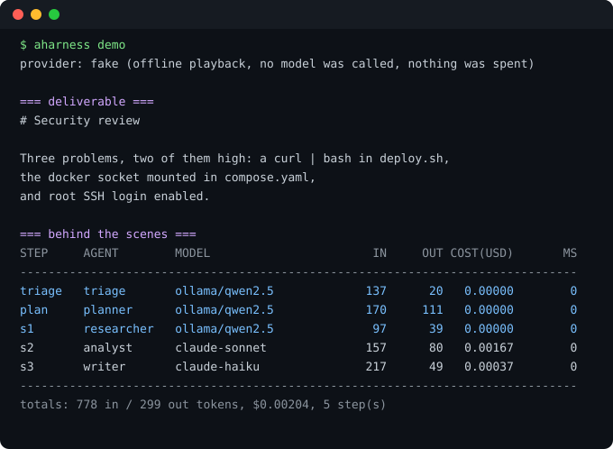

# agent-harness

**One task in, the right model per sub-task out, with the receipts.** A from-scratch orchestrator: triage decides whether a job needs one agent or several, a planner breaks it into steps, a blackboard carries the artifacts between agents, and every decision lands in an append-only trace with tokens and cost.

[](https://pypi.org/project/agent-harness-orchestrator/)
[](LICENSE)
[](pyproject.toml)

Built as the code behind the *Agentic Harness Orchestrator* blueprint: a Python while loop over a shared state dictionary, not a framework wrapper.



```bash
pipx install agent-harness-orchestrator
aharness demo          # offline playback, no keys, no spend
aharness models        # what each model is good at and what it costs
aharness run "Review this codebase for security flaws" --live    # real models
```

Naming: the distribution is `agent-harness-orchestrator`, the import is `agent_harness`, the command is `aharness`. `agent-harness`, `aharness`, `agentharness` and `harness-orchestrator` were either taken or rejected by PyPI as too close to an existing project, so the distribution carries the repository's own name. Nothing you type changes: install the distribution, run `aharness`.

## What the demo actually shows

That capture is a real run of the committed code. Triage and planning went to the free local model, research to the free local model, the judgement step to the reasoning model, and the writing to the cheap one: **$0.00204 for the whole job, 778 tokens in, 299 out**. Send the same four calls to the reasoning model and it costs several times that for no better result on the easy steps.

Honesty about that number: the trace says `provider: fake`, the token counts are estimates (four characters per token) because no model reported usage, and the dollar figure is those estimates against the example price list. It demonstrates the accounting, not a benchmark.

## How it maps to the blueprint

| Blueprint decision | What is in the code |
|---|---|
| Abstraction layer, core never calls a provider API | `providers/base.py` defines `Provider`; `providers/litellm_provider.py` is the only file that imports a vendor SDK, and only when `--live` is passed |
| Simple tasks bypass the multi-agent loop | Triage returns `direct` with one agent, or `decompose`; the direct route skips planning entirely |
| LLM-based routing with a cheap model | Triage and planning both go to `registry.cheapest_with("cheap")`, never the flagship |
| Agent team testing is Phase 2 | Not here. This is the harness only, so it can be stable first |
| Strengths from static config | `examples/models.json`: hand-curated profiles with strengths, speed and price per 1k tokens |
| Blackboard instead of a growing transcript | `blackboard.py`: keyed values, versions, provenance, a per-key and total size ceiling |
| Custom implementation first | No LangGraph, no LangChain. A loop, a dict, and strict JSON contracts |

## The contracts, and what happens when a model ignores them

Every model answer that drives control flow is JSON and is validated before it is trusted: the route must be `direct` or `decompose`, a named agent must exist in the roster, every step must declare the blackboard keys it writes, and the plan cannot exceed the step ceiling.

A reply that fails validation gets **one repair attempt** with the error fed back. A second failure is not a crash: it becomes a logged fallback (`fallback` event in the trace, `triage_source: "fallback"` on the result) and the run continues on the safe single-agent path. You can see which happened without reading logs, because it is a field.

## Bounds

Three ceilings, all enforced per step, all reported with the partial trace when they trip: `--max-steps` (default 8), `--max-cost` (default $0.25), and a wall clock (default 120s). `--max-cost 0` is a valid, useful setting meaning "do not spend", and it means that.

Exit codes are a contract: `0` success, `2` usage or config, `3` contract violation, `4` budget refused, `5` missing optional dependency, `6` provider failure, `7` execution refused. See the Phase 0 section below for what each guarantee means.

## Live run against real models (NVIDIA NIM)

The scripted suite proves mechanics. This section is what happened when the harness was pointed at a real OpenAI-compatible endpoint with a real key, because that is the only way to find out whether models honour the contracts.

**The endpoint's model list is not a capability list.** `/v1/models` advertised 85 ids. Of the 58 chat-capable ones, 43 returned `404 Function not found for account` (not provisioned on the key), several hit end-of-life (`410 Gone`, e.g. `meta/llama-3.1-8b-instruct`), and a handful return `200` with empty content when the token budget is smaller than their hidden reasoning. Ten actually answered. `scripts/live_probe.py` exists because of this: probe, do not trust the catalogue.

**Contract compliance across those ten**, asking each to route a task as the harness's own triage step does:

| model | contract | route it chose | latency |
|---|---|---|---|
| nemotron-3.5-bolt-e4b | clean | direct | 0.8s |
| nemotron-3-nano-omni-30b-a3b-reasoning | clean | direct | 2.0s |
| nemotron-3-ultra-550b-a55b | clean | decompose | 3.5s |
| ising-calibration-1.5-31b | clean | decompose | 2.8s |
| gpt-oss-20b | clean | direct | 6.9s |
| minimax-m3.1-flash | clean | direct | 12.1s |
| nemotron-3.5-lightning-30b-a3b | clean after buying room | direct | 16.9s |
| muse-glimmer-30b | clean after buying room | decompose | 43.2s |
| mistral-large-4-1t-a52b | clean after buying room | decompose | 62.3s |
| laguna-xs-2.1 | provider error | - | 1.7s |

Nine of ten complied. The three that needed help are the interesting part: they are reasoning models that spend the output budget thinking, so a 320-token ceiling truncated the answer and looked identical to a model ignoring the contract. The harness now distinguishes the two, buys more room once, and records `truncated` in the trace.

**A full orchestrated run**, real models, real tokens, no script: triage and planning on the smallest ranked model, analysis on `gpt-oss-20b`, writing on `nemotron-3.5-bolt-e4b`.

```
STEP     AGENT        MODEL                       IN     OUT COST(USD)       MS
-------------------------------------------------------------------------------
triage   triage       nvidia/nemotron-3.5-bo     159      41   0.00000      952
plan     planner      nvidia/nemotron-3.5-bo     199     174   0.00000     3157
s1       analyst      openai/gpt-oss-20b         246     275   0.00000     8214
s2       researcher   nvidia/nemotron-3.5-li     310    1500   0.00000    14221
s2       researcher   nvidia/nemotron-3.5-li     310    2528   0.00000    25796
s3       writer       nvidia/nemotron-3.5-bo     661     345   0.00000     5816
-------------------------------------------------------------------------------
totals: 1885 in / 4863 out tokens, $0.00000, 6 step(s)
```

58 seconds wall clock, six provider calls for five logical steps, one of them the truncation retry on `s2`. The deliverable correctly named the mounted docker socket, the `curl | bash`, and root SSH login, with evidence per finding. The dollars read zero because NIM is credit-metered and the profiles carry no per-token price: the token counts are measured, the cost column is not.

Two honest observations from that run, both visible in the trace:

- The planner ordered `analyst` before `researcher`, so the analyst ran with its declared input `findings` still absent. The harness records the missing key in the prompt and lets the step proceed. That is the wrong default for a plan that declares dependencies, and it is the next thing to fix.
- Reasoning models can burn a 1500-token budget before producing a character, which is why the retry doubles to 4500 rather than nudging.

## Phase 0 hardening (0.3.0)

Phase 0 changed the guarantees, not the feature list. Every claim below is enforced in code and has a regression test behind it that runs offline.

**Nothing is called before it is paid for.** Each provider call is quoted, reserved against the budget, and only then made. The quote covers the permitted retry allowance, so a call that may be attempted three times is funded three times before the first attempt. Triage, planning, steps, JSON repairs and truncation retries all pass through the same reservation path. A zero budget refuses at the first call rather than partway through a run, and the trace shows `status: budget_exceeded` with no spend.

**Unknown pricing is never zero.** A model whose price is not modelled (credit-metered endpoints such as NVIDIA NIM, private deployments) is quoted at a configurable conservative rate (`AHARNESS_UNKNOWN_PRICING_PER_1K`, default $0.01 per 1k tokens) and every such call is flagged `conservative: true`. Estimated and actual cost are recorded as separate fields; the totals line reports both.

**Authority comes from the roster, never from the plan.** An agent may write only the keys its roster entry declares. The keys `task` (and anything prefixed `_`) belong to the harness. A plan that tries to grant a step a key the agent does not declare is rejected as a contract violation, so a planner cannot escalate its agents. Every refused write is recorded as a `write_rejected` event naming the agent, key and reason. User inputs can seed the board before execution but cannot overwrite system state afterwards, and one agent cannot silently replace another agent's artifact.

**Dependencies are proved, not assumed.** Before execution, every step's declared inputs must resolve to something supplied or produced by the plan. A reference nothing produces is rejected, a cycle is rejected with the cycle named, and a plan whose declared order violates its own dependencies is executed in a stable topological order with the reordering recorded in the trace rather than applied silently. At execution time a step with a missing input raises instead of running on partial context.

**Provider failures have causes.** Timeouts, rate limits, auth failures, unprovisioned models, malformed responses and invalid requests are distinct exceptions with distinct handling. Retries are bounded, counted, and included in the budget quote. A truncated answer buys more room once instead of being reported as a contract violation. Transport failures are retryable; client errors are not, so a bad request cannot burn quota.

**A failed run is still explainable.** Every event carries the run id and every provider call a call id. Artifacts are recorded with a sha256 of their content, so a delivered value can be proved to match the trace. Each call records tokens, estimated cost, actual cost, duration, attempts, finish reason and budget remaining. Rejections, fallbacks, truncation and validation outcomes are events, and `run_end` carries a terminal status. Strings are scrubbed of credential-shaped content before they are written, because the trace is a file people paste into reports.

### Phase 0.1: independent audit remediation (0.3.1)

An independent review of Phase 0 found eight defects. All eight were reproduced against `6eeeb7b` before any change, then fixed.

**The budget is thread-safe.** Reservation, settlement and release all mutate under one lock, so check-and-insert is atomic: 200 threads racing a limit that affords 20 reservations accept exactly 20, across fifty rounds. A duplicate settlement is refused with a typed `ReservationError` rather than silently double-charging, and reservations left open at the end of a run are claimed as uncertain rather than dropped.

**Cost now has four categories, never three.** Confirmed spend, estimated cost, uncertain cost and outstanding reservations are reported separately. A request that may have been received and billed but whose usage we cannot read (timeout, unusable response, malformed usage) moves its quote into `uncertain_usd`, which consumes budget headroom exactly like real spend and is never described as free or as confirmed. A rejected request (401, 404, 400) releases its reservation and is recorded as `not_billed`.

**Settling more than was reserved is an event, not a surprise.** An actual charge above its quote produces `budget_overrun` with the amount, and a charge that takes confirmed plus uncertain spend past the limit exhausts the budget: every later call is refused with the reason.

**Malformed usage is typed, not coerced.** A negative count, a boolean, a string or a NaN cannot be costed, so it raises `ProviderBadResponse`. Absent usage is estimated and flagged `usage_reported: false`, which is a different thing from usage that is present and wrong. A non-JSON body returned with HTTP 200 is also a `ProviderBadResponse`, carrying a truncated snippet and no credentials.

**Invalid plans are rejected before any step spends.** Two steps writing the same key, a step declaring the same output twice, and a step reading what it writes are all contract violations at validation time. The earlier behaviour spent four provider calls and then died at runtime on an overwrite.

**The overwrite bypass is gone.** `write()` no longer takes `allow_overwrite`; a correction goes through `replace()`, which requires a module-internal authority sentinel and a non-empty reason and appends an audit record with the new hash. This is an API boundary, not a sandbox against arbitrary Python in the same process.

**Retry attribution is per call.** Counters on a provider are locked process-wide totals for reporting only; the attempt count a trace records comes attached to the `Completion` for that specific call, so two orchestrators sharing one provider cannot corrupt each other's numbers.

**Every run ends with a terminal event.** That includes unexpected exceptions, which previously escaped without a `run_end`, leaving a run nobody could audit. Open reservations are claimed at that point, so the accounting still balances.

### Exit codes

`0` success, `2` usage or config, `3` contract violation, `4` budget refused, `5` missing optional dependency, `6` provider failure, `7` execution refused (permission, overwrite or unmet dependency). A provider failure previously fell through to the generic handler and was reported as a usage error; it now has its own code and prints the evidence for the failed run.

## What this is not

- **Live-tested on ten NVIDIA NIM models, not benchmarked.** Contract compliance was measured there; whether the routing choice is the best one remains unmeasured, and the harness does not claim otherwise. Routing quality is The routing decision is a model call with a JSON contract. Whether it picks the best agent is unmeasured, and the README does not claim otherwise.
- **Not a tool-calling framework.** Agents read and write blackboard keys. No filesystem, no shell, no browsing.
- **Not a team simulator.** No agent-to-agent debate or critique loops. The blueprint kept that for Phase 2, deliberately.
- **No committed model calls in the suite.** 148 tests run against a scripted provider in under a second, so the suite proves the mechanics, not model quality. `--live` is the real path and needs the `[litellm]` extra and your own keys.
- **Price table is a snapshot**, hand-entered from public pages. It will drift; edit `examples/models.json`.
- **Estimates over-reserve.** A quote assumes the full output budget is used, so estimated cost runs well above actual (the demo shows $0.00204 actual against $0.02010 estimated). That is the safe direction, and it means a tight budget refuses earlier than strictly necessary.
- **Execution is sequential.** Phase 0 deliberately introduced no parallelism; dependency ordering repairs behaviour rather than adding throughput.

## Layout

```
agent_harness/
  registry.py       model profiles, cheapest-capable selection
  roster.py         agents: model + system prompt + declared outputs
  plan.py           the two JSON contracts, extraction and validation
  blackboard.py     shared state with provenance and size ceilings
  orchestrator.py   triage, plan, execute, deliver
  trace.py          append-only JSONL plus the table you saw above
  providers/        base protocol, scripted fake, litellm adapter
  cli.py            aharness run / demo / models / agents / trace
```

## License

MIT.
